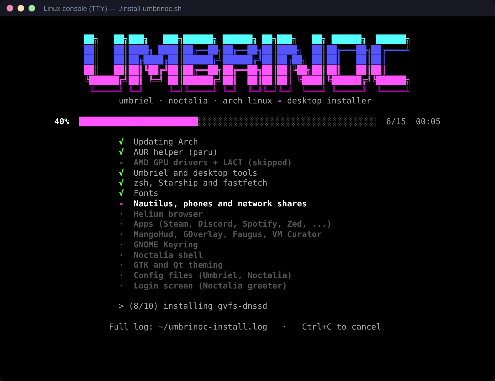

<h1 align="center">UMBRINOC</h1>

<p align="center">
  <b>A one-script Umbriel + Noctalia desktop for Arch Linux</b><br>
  Turns a fresh Arch install into a complete <a href="https://github.com/noctalia-dev/umbriel">Umbriel</a> desktop with the
  <a href="https://github.com/noctalia-dev/noctalia">Noctalia</a> shell and login screen, AMD drivers, apps,
  fonts and a themed zsh — from the official repos and the AUR, no Flatpak.
</p>

<p align="center">
  <a href="https://github.com/lmaule/arch-umbriel-noctalia/actions/workflows/install-test.yml"></a>
  <a href="LICENSE"></a>
  
</p>

| In kitty and other modern terminals | On the Linux console (TTY) |
|---|---|
|  |  |

## Highlights

- **Umbriel + Noctalia**, both by the Noctalia developers: a scrolling-tiling compositor with blur and fluid animations, and the shell on top.
- **Noctalia login screen** (greetd), and your login password unlocks GNOME Keyring.
- **Matching colours everywhere:** GTK, Qt, kitty and btop follow Noctalia's theme.
- **AMD RX 9000 ready:** Mesa/RADV, firmware, 32-bit drivers and LACT, detected automatically.
- **Apps and gaming:** Helium, Steam, Discord, Spotify, Zed, qBittorrent, ProtonPlus, Claude Desktop, MangoHud, Faugus Launcher, VM Curator.
- **A friendly installer:** questions up front, one password prompt, a progress screen, retry/skip on errors, and a full log.

## Quick start

**You need:** a fresh Arch Linux install (made with [archinstall](https://wiki.archlinux.org/title/Archinstall), which
sets up networking, Bluetooth and power management), a normal user with `sudo`, and an internet connection.

Run as your normal user, not root:

```bash
git clone https://github.com/lmaule/arch-umbriel-noctalia.git
cd arch-umbriel-noctalia
./install-umbrinoc.sh
```

What happens:

1. It shows what it will install and asks its questions (continue, enable multilib, …).
2. It asks for your **sudo password once** and reuses it for the whole install.
3. A progress screen shows each step as it runs. Everything is logged to `~/umbrinoc-install.log`.
4. If a step fails, you see the end of the log and can **retry**, **skip** or **quit**.
5. A summary lists anything worth checking, then offers to reboot.

After rebooting, choose the **Umbriel** session at the Noctalia login screen.

> **Heads-up:** [Umbriel](https://github.com/noctalia-dev/umbriel) is young. Its own README says configuration keys,
> keybinds and behaviour may change between releases, and on Arch it's only packaged as `umbriel-git` (built from its
> latest code). If an update breaks something, `umbriel config validate` shows what changed in the config.

### Options

| Flag | What it does |
|---|---|
| `--git` | Use the development (`-git`) packages for Noctalia and the greeter |
| `--no-greeter` | Skip the login screen (start Umbriel from a TTY with `start-umbriel`) |
| `--no-blur` | Leave out the blur settings |
| `--amd-gpu` / `--no-amd-gpu` | Force or skip the AMD driver step (default: detect an AMD card) |
| `--yes` | Answer yes to every question, stop on the first error, never reboot |
| `--verbose` | Show the full output instead of the progress screen |

## What it installs

| Area | Packages |
|---|---|
| Desktop | Umbriel¹ (with its screen-sharing portal and Xwayland), `noctalia`, `xdg-desktop-portal-gtk`, PipeWire, `polkit`, `upower` |
| Login screen | `greetd`, `noctalia-greeter` |
| AMD GPU | `mesa`, `vulkan-radeon`, `linux-firmware-amdgpu`, 32-bit drivers, `lact`, `rocm-smi-lib`, `vulkan-tools`, `mesa-utils`, `libva-utils` |
| Terminal & shell | `kitty`, `zsh` (completions, autosuggestions, syntax highlighting), `starship`, `btop`, `fastfetch` |
| Fonts | `noto-fonts`, `noto-fonts-cjk`, `noto-fonts-emoji`, `ttf-jetbrains-mono-nerd`, Nerd Font symbols |
| Files | `nautilus`, `xdg-user-dirs`, `gvfs` (phones, SMB, NFS, network discovery, iPhone, cameras), `avahi`, `nss-mdns`, `ffmpegthumbnailer` |
| Passwords | `gnome-keyring`, `libsecret`, `seahorse` |
| Theming | `adw-gtk-theme`, `nwg-look`, `qt5ct`, `qt6ct`, `capitaine-cursors`, `dconf` |
| Apps | Helium¹, Steam, Discord, Spotify¹, ProtonPlus¹, Claude Desktop¹, `qbittorrent`, `zed` |
| Gaming & VMs | `mangohud`, `goverlay`, Faugus Launcher¹, VM Curator¹ (+ `edk2-ovmf` and `swtpm` for UEFI / Windows 11 VMs) |

¹ From the AUR (`umbriel-git`, `helium-browser-bin`, `spotify`, `protonplus`, `claude-desktop`, `faugus-launcher`, `vm-curator-bin`).
AUR packages are maintained by the community, not by the app developers. If no AUR helper is installed, `paru` is set up first.

## What it configures

**Desktop**
- **Umbriel** gets the split config from `config/umbriel/`. An existing `~/.config/umbriel` is backed up first.
  If niri is installed, the installer offers to remove it (your `~/.config/niri` is kept).
- **Noctalia** gets `config/noctalia/config.toml`: its polkit agent (password prompts for apps) and colour templates.
- **Login screen:** greetd runs the Noctalia greeter, and any previous display manager is disabled.
- **Screenshots** are taken by Noctalia, saved to `~/Pictures/Screenshots` and copied to the clipboard.

**Look and feel**
- GTK apps use `adw-gtk3`, Qt apps use qt5ct/qt6ct, with the capitaine cursor theme.
- Noctalia's templates colour GTK, Qt, kitty and btop to match your theme (and your wallpaper, if you theme from it).
- kitty uses JetBrains Mono Nerd Font. zsh becomes your login shell, with the Starship *Pastel Powerline* prompt and fastfetch.

**Everyday details**
- Your login password unlocks GNOME Keyring, and `passwd` keeps the two in sync.
- Helium is the default browser, and Nautilus opens folders.
- Nautilus's sidebar lists Documents, Downloads, Music, Pictures and Videos, as on GNOME.
- Network shares are discoverable, and `.local` hostnames resolve.

Every system file it edits is backed up first as `<file>.bak.<timestamp>`, and re-running it is safe.

## Keybinds

`Mod` is the Super (Windows) key. Press `Mod+Shift+/` to see every bind on screen.

| Key | Action | | Key | Action |
|---|---|---|---|---|
| `Mod+Return` | Terminal (kitty) | | `Mod+Q` | Close window |
| `Mod+B` | Browser (Helium) | | `Mod+T` | Toggle floating |
| `Mod+E` | Files (Nautilus) | | `Mod+F` | Maximise column |
| `Mod+Shift+E` | Text editor (Zed) | | `Mod+O` | Overview |
| `Mod` (tap) or `Mod+Space` | App launcher | | `Mod+1`…`9` | Go to workspace |
| `Mod+S` | Control center | | `Alt+Tab` | Window switcher |
| `Mod+Shift+S` | Noctalia settings | | `Ctrl+Shift+1/2/3` | Screenshot: region / screen / window |
| `Mod+Alt+L` | Lock screen | | `Mod+←→↑↓` | Move focus |
| `Mod+Shift+Q` | Session menu | | | |

<details>
<summary><b>All keybinds</b></summary>

| Key | Action |
|---|---|
| **Apps** | |
| `Mod+Return` | kitty |
| `Mod+B` | Helium |
| `Mod+E` | Nautilus |
| `Mod+Shift+E` | Zed |
| **Noctalia** | |
| `Mod` (tap), `Mod+Space` or `Mod+Ctrl+Return` | Launcher |
| `Mod+S` | Control center |
| `Mod+Shift+S` or `Mod+Shift+Comma` | Settings |
| `Mod+Shift+Return` | Wallpaper picker |
| `Mod+Shift+Q` | Session menu (log out, reboot, shut down) |
| `Mod+Alt+L` | Lock screen |
| `Alt+Tab` / `Alt+Shift+Tab` | Window switcher |
| `Ctrl+Shift+1` / `2` / `3` | Screenshot: region / screen / window |
| **Windows** | |
| `Mod+Q` | Close window |
| `Mod+←→↑↓` or `Mod+H/J/K/L` | Move focus |
| `Mod+Ctrl+←→↑↓` or `Mod+Ctrl+H/J/K/L` | Move window or column |
| `Mod+Home` / `Mod+End` | First / last column |
| `Mod+Ctrl+Home` / `Mod+Ctrl+End` | Move column to the start / end |
| `Mod+[` / `Mod+]` | Move window into / out of the column on the left / right |
| `Mod+,` / `Mod+.` | Pull the next window into the column / push this one out |
| `Mod+T` | Toggle floating |
| `Mod+Shift+V` | Switch focus between floating and tiled windows |
| `Mod+F` / `Mod+Shift+F` / `Mod+M` | Maximise column / fullscreen / maximise to screen edges |
| `Mod+P` | Pin (keep on top across workspaces) |
| `Mod+W` | Tabbed column |
| `Mod+C` | Centre column |
| `Mod+R` / `Mod+Shift+R` | Cycle column widths |
| `Mod+Ctrl+Shift+R` / `Mod+Ctrl+R` | Cycle window heights |
| `Mod+-` / `Mod+=` | Column narrower / wider |
| `Mod+Shift+-` / `Mod+Shift+=` | Window shorter / taller |
| `Mod+Ctrl+F` | Fill the screen width |
| `Mod+Shift+Space` / `Mod+Ctrl+Space` | Send window to the scratchpad / show or hide the scratchpad |
| **Workspaces and monitors** | |
| `Mod+1`…`9` | Go to workspace (press again to go back) |
| `Mod+Ctrl+1`…`9` | Move column to workspace |
| `Mod+Tab` | Previous workspace |
| `Mod+O` or the top-left screen corner | Overview |
| `Mod+scroll wheel` | Switch workspace (`+Ctrl` moves the column) |
| `Mod+Shift+←→↑↓` | Focus another monitor (`+Ctrl` moves the column there) |
| **System** | |
| `Mod+Shift+/` or `Mod+Shift+Escape` | Show all keybinds |
| `Mod+Escape` | Get your shortcuts back from a fullscreen app that grabbed them |
| `Mod+Shift+P` / `Mod+Ctrl+P` | Monitors off / on |
| `Ctrl+Alt+Delete` | Quit Umbriel (asks first) |
| Volume, mic, media and brightness keys | Handled by Noctalia, with on-screen display |

</details>

## Customising

Edit the files in `~/.config/umbriel/cfg/`; Umbriel applies them as soon as you save and shows any mistakes on screen
(or run `umbriel config validate`). Noctalia settings changed in its
Settings window are saved separately, in `~/.local/state/noctalia/settings.toml`.

<details>
<summary><b>Repo layout</b></summary>

The config is split into small files, based on Umbriel's example config and Noctalia's Umbriel guide.

```text
config/                       → copied to ~/.config/
├── umbriel/
│   ├── config.toml           # just includes the files below
│   └── cfg/
│       ├── general.toml      # autostart, workspaces, hot corner
│       ├── environment.toml  # environment variables (Qt theme, Electron)
│       ├── input.toml        # keyboard, touchpad, mouse, cursor
│       ├── appearance.toml   # borders, rounded corners
│       ├── layout.toml       # scrolling layout, gaps, column widths
│       ├── rules.toml        # window rules
│       ├── blur.toml         # blur (left out with --no-blur)
│       ├── keybinds.toml     # all keybinds
│       └── outputs.toml      # monitor setup (commented example)
└── noctalia/
    └── config.toml           # polkit agent, colour templates
etc/dconf/                    → copied to /etc/dconf/ (GTK theme, cursor defaults)
.github/workflows/            # the install test
install-umbrinoc.sh
```

</details>

## Updating

```bash
cd arch-umbriel-noctalia
git pull
./install-umbrinoc.sh
```

Re-running only changes what's different. If the repo's Umbriel or Noctalia config has changed and you've edited
yours, your version is moved to `~/.config/umbriel.bak.<timestamp>` (or `config.toml.bak.<timestamp>`) first, so you can
copy your changes back.

## After installing

- **Check the GPU:** `vulkaninfo --summary` should list your Radeon card with the RADV driver.
- **GPU control:** open LACT for fan curves and power limits. Overclocking must be enabled in LACT's settings, then reboot.
- **More Noctalia commands:** `noctalia msg --help` lists everything you can bind to a key.

## Troubleshooting

| Problem | What to do |
|---|---|
| A step failed | Press **r** to retry, or check `~/umbrinoc-install.log`. Run with `--verbose` to watch the output live. |
| AMD step says *skipped* | The start screen says whether an AMD GPU was found. Use `--amd-gpu` to force it. |
| Saved passwords keep asking to be unlocked | Open *Passwords and Keys* and make sure the **Login** keyring's password matches your login password. |
| Umbriel ignores your config edits | Run `umbriel config validate` to see the error. Your previous config is in `~/.config/umbriel.bak.*`. |

> **About the sudo password:** while the installer runs, it's kept in a file only your user can read, in your
> runtime folder (in memory, not on disk), so build tools like `makepkg` can use it. It's deleted when the
> installer exits. If your user has passwordless sudo, nothing is asked or stored.

## Testing

On every push, and every Monday, a [GitHub test](.github/workflows/install-test.yml) runs the installer in an Arch
Linux container with real packages, validates the Umbriel config with Umbriel, and checks the installed files and apps.
A container can't boot or test the login screen and GPU, so the first install on real hardware is the final check.

## Credits

- [Umbriel](https://github.com/noctalia-dev/umbriel) and [Noctalia](https://github.com/noctalia-dev/noctalia) by the
  Noctalia developers. The Umbriel config is based on Umbriel's example config and Noctalia's Umbriel guide.
- The keybind layout and the dconf defaults come from
  [cachyos/cachyos-niri-noctalia](https://github.com/cachyos/cachyos-niri-noctalia) (GPL-3.0), originally for niri.

## License

[GPL-3.0](LICENSE). Parts are derived from GPL-3.0 work (see Credits), so the whole repo uses the same licence.
