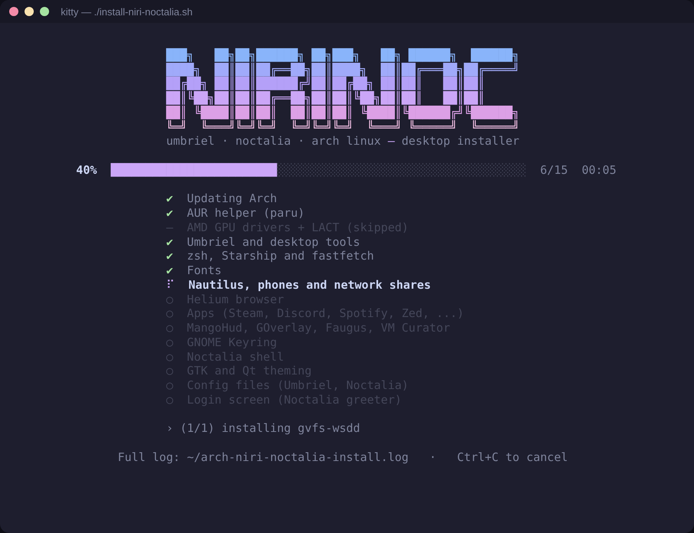

# arch-niri-noctalia

[](https://github.com/lmaule/arch-niri-noctalia/actions/workflows/install-test.yml)

One script that turns a fresh Arch Linux install into a complete
[niri](https://github.com/niri-wm/niri) desktop with the
[Noctalia](https://github.com/noctalia-dev/noctalia) shell and
[Noctalia greeter](https://github.com/noctalia-dev/noctalia-greeter), plus AMD
drivers, apps, fonts and a zsh setup. Everything comes from the official Arch
repos or the AUR. No Flatpak.

> Designed to run after [archinstall](https://wiki.archlinux.org/title/Archinstall),
> which should already have set up networking, Bluetooth and power management.

## Quick start

Run as your normal user, not root. The script uses `sudo` where it needs it.

```bash
git clone https://github.com/lmaule/arch-niri-noctalia.git
cd arch-niri-noctalia
./install-niri-noctalia.sh
```

The installer asks its questions and your sudo password once at the start. After that
it shows a progress screen instead of the full package output:



- Everything it does is logged to `~/arch-niri-noctalia-install.log` (the previous run is kept as `.old`).
- If a step fails, it shows the end of the log and lets you **retry**, **skip** or **quit**.
- At the end you get a summary of anything worth checking, and an offer to reboot.

Reboot when it finishes, then choose the **niri** session at the Noctalia greeter.

### Options

| Flag | What it does |
|---|---|
| `--git` | Use the development (`-git`) packages for Noctalia and the greeter |
| `--no-greeter` | Skip greetd and the Noctalia greeter (start niri from a TTY with `niri-session`) |
| `--no-blur` | Skip the blur rules (they need niri 26.04 or newer) |
| `--amd-gpu` / `--no-amd-gpu` | Force or skip the AMD driver step (default: detect an AMD card) |
| `--yes` | Don't ask questions: answer yes to all of them (multilib, removing AMDVLK and spotify-launcher), stop on the first error, never reboot |
| `--verbose` | Show the full output instead of the progress screen (also used automatically when the output isn't a terminal) |

## What it installs

| Area | Packages |
|---|---|
| Desktop | `niri`, `noctalia`, `xwayland-satellite`, `xdg-desktop-portal-gnome`, `xdg-desktop-portal-gtk`, `fuzzel`, PipeWire, `polkit`, `upower` |
| Login screen | `greetd`, `noctalia-greeter` |
| AMD GPU (RX 9000 / RDNA 4) | `mesa`, `vulkan-radeon`, `linux-firmware-amdgpu`, 32-bit drivers, `lact`, `rocm-smi-lib`, `vulkan-tools`, `mesa-utils`, `libva-utils` |
| Terminal & shell | `kitty`, `zsh` with completions, autosuggestions and syntax highlighting, `starship`, `btop`, `fastfetch` |
| Fonts | `noto-fonts`, `noto-fonts-cjk`, `noto-fonts-emoji`, `ttf-jetbrains-mono-nerd`, Nerd Font symbols |
| Files | `nautilus`, `xdg-user-dirs`, `gvfs` (MTP, SMB, NFS, network discovery, iPhone, cameras), `avahi`, `nss-mdns`, `ffmpegthumbnailer` |
| Passwords | `gnome-keyring`, `libsecret`, `seahorse` |
| GTK & Qt theming | `adw-gtk-theme`, `nwg-look`, `qt5ct`, `qt6ct`, `capitaine-cursors`, `dconf` |
| Apps | Helium browser (`helium-browser-bin`, AUR), Steam, Discord, Spotify (`spotify`, AUR), ProtonPlus (AUR), Claude Desktop (`claude-desktop`, AUR) |

If no AUR helper is installed, the script installs `paru` first.

## What it configures

- **niri:** installs the split config from `config/niri/` (layout and keybinds from CachyOS, see below).
  If you already have a different `~/.config/niri`, it's moved to `~/.config/niri.bak.<timestamp>` first.
  On niri older than 26.04, or with `--no-blur`, the blur file is switched off.
- **Noctalia:** installs `config/noctalia/config.toml`, which turns on Noctalia's polkit agent and its colour templates for GTK, Qt, kitty and btop.
  Other files in `~/.config/noctalia/` are left alone.
- **GTK defaults:** dark `adw-gtk3` and the capitaine cursor theme are set system-wide through dconf (`etc/dconf/`).
- **App theming:** GTK apps use `adw-gtk3` and Qt apps use qt5ct/qt6ct (`QT_QPA_PLATFORMTHEME=qt5ct` in niri, which covers both).
  Noctalia's `gtk3`, `gtk4`, `qt`, `kitty` and `btop` colour templates are switched on, so these apps follow Noctalia's colours (and your wallpaper, if you theme from it).
- **Login:** greetd runs the Noctalia greeter, and any previous display manager is disabled.
- **Keyring:** your login password unlocks GNOME Keyring automatically, and `passwd` keeps the two passwords in sync (PAM).
- **Shell:** zsh becomes your login shell. A starter `~/.zshrc` is written if you don't have one, with the Starship *Pastel Powerline* preset and fastfetch on every new terminal.
- **Defaults:** Helium is the default browser and Nautilus opens folders. kitty uses JetBrains Mono Nerd Font.
- **Screenshots:** saved to `~/Pictures/Screenshots` and copied to the clipboard.
- **Network shares:** Avahi is enabled, and `.local` hostnames resolve.

Every system file the script edits is backed up first as `<file>.bak.<timestamp>`.
Running the script again is safe: it skips anything it has already added.

## Repo layout

The config is split into small files, following
[CachyOS's niri + Noctalia settings](https://github.com/cachyos/cachyos-niri-noctalia).

```text
config/                       → copied to ~/.config/
├── niri/
│   ├── config.kdl            # just includes the files below
│   └── cfg/
│       ├── animation.kdl     # animation curves and springs
│       ├── autostart.kdl     # starts Noctalia
│       ├── blur.kdl          # blur rules (niri 26.04+)
│       ├── display.kdl       # monitor setup (commented example)
│       ├── input.kdl         # keyboard, touchpad, mouse
│       ├── keybinds.kdl      # all keybinds
│       ├── layout.kdl        # gaps, column widths
│       ├── misc.kdl          # environment variables, cursor, misc
│       └── rules.kdl         # window and layer rules
└── noctalia/
    └── config.toml           # polkit agent, colour templates (GTK, Qt, kitty, btop)
etc/dconf/                    → copied to /etc/dconf/ (GTK theme, cursor defaults)
install-niri-noctalia.sh
```

To change your setup, edit the files in `~/.config/niri/cfg/`. niri reloads them as soon as you save.
Running the script again only replaces them if they differ from the repo, and backs up your version first.

## Keybinds

`Mod` is the Super (Windows) key. Press `Mod+Shift+Escape` or `Mod+Shift+/` to see every bind on screen.

| Key | Action |
|---|---|
| **Apps** | |
| `Mod+Return` | kitty |
| `Mod+B` | Helium |
| `Mod+E` | Nautilus |
| `Mod+D` | fuzzel |
| **Noctalia** | |
| `Mod+Space` or `Mod+Ctrl+Return` | Launcher |
| `Mod+S` | Control center |
| `Mod+Shift+S` or `Mod+Shift+Comma` | Settings |
| `Mod+Shift+Return` | Wallpaper picker |
| `Mod+Shift+Q` | Session menu (log out, reboot, shut down) |
| `Mod+Alt+L` | Lock screen |
| `Alt+Tab` / `Alt+Shift+Tab` | Window switcher |
| **Windows** | |
| `Mod+Q` | Close window |
| `Mod+←→↑↓` or `Mod+H/J/K/L` | Move focus |
| `Mod+Ctrl+←→↑↓` or `Mod+Ctrl+H/J/K/L` | Move window or column |
| `Mod+Home` / `Mod+End` | First / last column |
| `Mod+[` / `Mod+]` | Move window into the column on the left / right |
| `Mod+,` / `Mod+.` | Take a window into / out of the column |
| `Mod+T` | Toggle floating |
| `Mod+Shift+V` | Switch focus between floating and tiled windows |
| `Mod+F` / `Mod+Shift+F` / `Mod+M` | Maximise column / fullscreen / maximise to screen edges |
| `Mod+W` | Tabbed column |
| `Mod+R` / `Mod+Shift+R` | Cycle column widths |
| `Mod+Ctrl+R` / `Mod+Ctrl+Shift+R` | Reset / cycle window height |
| `Mod+-` / `Mod+=` | Column narrower / wider |
| `Mod+Shift+-` / `Mod+Shift+=` | Window shorter / taller |
| `Mod+C` / `Mod+Ctrl+C` / `Mod+Ctrl+F` | Centre column / centre visible columns / fill width |
| **Workspaces and monitors** | |
| `Mod+1`…`9` | Go to workspace |
| `Mod+Ctrl+1`…`9` | Move column to workspace |
| `Mod+Tab` | Previous workspace |
| `Mod+O` | Overview |
| `Mod+scroll wheel` | Switch workspace (`+Ctrl` moves the column) |
| `Mod+Shift+←→↑↓` | Focus another monitor (`+Ctrl` moves the column there) |
| **System** | |
| `Ctrl+Shift+1` / `2` / `3` | Screenshot: region / screen / window (saved to `~/Pictures/Screenshots`) |
| `Mod+Shift+P` | Turn monitors off |
| `Mod+Escape` | Get your shortcuts back from a fullscreen app that grabbed them |
| `Ctrl+Alt+Delete` | Quit niri |
| Volume, mic, media and brightness keys | Handled by Noctalia, with on-screen display |

## After installing

- **Check the GPU:** run `vulkaninfo --summary`. It should list the RX 9070 XT with the RADV driver.
- **GPU control:** open LACT for fan curves and power limits. Overclocking has to be enabled in LACT's settings, then you reboot.
- **Saved logins:** if share or app passwords keep asking to be unlocked, open *Passwords and Keys* and make sure the **Login** keyring's password matches your login password.
- **Noctalia commands:** run `noctalia msg --help` to list everything you can bind to a key.

## Notes

- Every push, and every Monday, a [GitHub test](.github/workflows/install-test.yml) runs the installer in an Arch Linux container with real packages and validates the niri config with niri.
  A container can't boot or test the login screen and GPU, so a first install on real hardware is still the final check.
- Spotify, Claude Desktop, Helium and ProtonPlus come from the AUR. The AUR packages are maintained by the community, not by the app developers.
- Blur needs niri 26.04+. On older versions the script skips it and adds it the next time you run the script.

## Credits

The niri config layout, keybinds, animations, rules and dconf defaults are based on
[cachyos/cachyos-niri-noctalia](https://github.com/cachyos/cachyos-niri-noctalia)
(GPL-3.0), with changes: kitty, Helium and fuzzel binds, Noctalia's documented binds,
qt5ct/qt6ct theming, blur moved into its own file, and Noctalia colour templates.
Blur and keybind recommendations also come from [Noctalia's niri docs](https://github.com/noctalia-dev/noctalia).

## License

[GPL-3.0](LICENSE). The config files are derived from GPL-3.0 work, so the whole repo uses the same licence.
